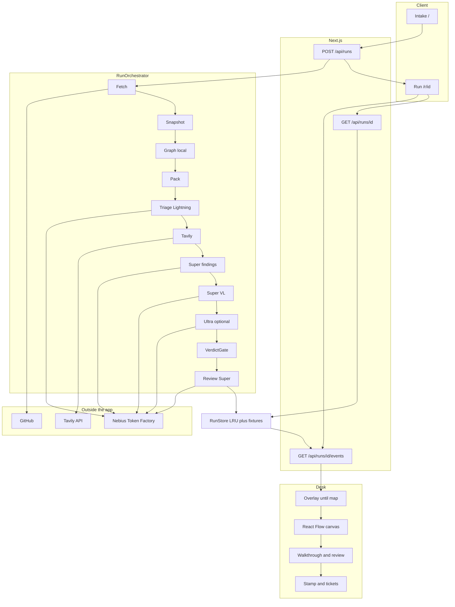
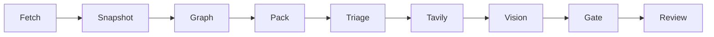
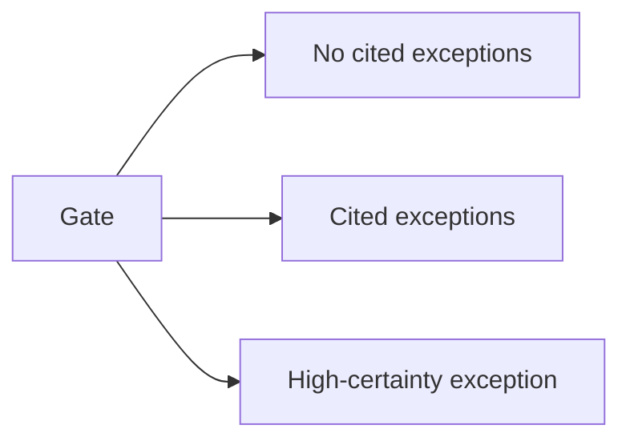

# MergeDesk

Orient a large pull request. See the files that matter, then a short list of cited exceptions. Stamps are **advisory**. Models never merge and never write patches. Public GitHub repos only.

Built for the Nebius x NVIDIA Global AI Hackathon (Coding and Agentic Engineering). Runtime models run on **Nebius Token Factory**. Package and API claims are checked with **Tavily**.

Open the app, paste a PR URL or click a fixture, and read the desk.

## Features

- **Intake.** Public GitHub PR URL, pasted issue and diff, or one-click fixtures.
- **Overlay.** Full-screen Fetch through Gate until the map lands, then a brass bar on the desk. Review hydrates after the stamp.
- **Canvas.** Zoom and pan the import neighborhood. Click a file to pin its findings and dim the rest.
- **Walkthrough.** Numbered change notes, who-does-what routing slips, and files grouped by job. The neighborhood map stays React Flow. Mermaid stays in the Action comment.
- **Review.** Read-only file comments and copyable suggested-diff tickets. The desk never applies patches.
- **Reading order.** Start-here files, changed-file +/−, and a caption that this map is not an execution trace.
- **Stamp.** Advisory labels only: **No cited exceptions**, **Cited exceptions**, **High-certainty exception**. Review comments do not move the stamp.
- **Tickets.** Kind, path, line, and quote. Coverage chips show what this run actually saw.
- **Grounding.** Tavily search for invented surfaces. Zero hits is not proof of absence.
- **Routing.** Local graph, small pack. Tree-sitter for JS, TS, and Python. Regex neighborhood for Go, Rust, C, Java, and similar. Nemotron on Token Factory: Lightning, Super, Super VL, Ultra.
- **Honesty.** Live, Fixture, or Replay badge. Estimate ledger. Spend caps. Prebaked Replay if the live path fails.

## Architecture

BLOCK is only a regex secret. Only VerdictGate sets the stamp. The hosted UI draws the neighborhood with React Flow. Mermaid is still generated for comments, not for the desk.

**System**



**Steps**



**Stamps**



## Setup

```bash
pnpm install
cp .env.example .env.local
```

Fill `.env.local`:

```
NEBIUS_API_KEY=
NEBIUS_BASE_URL=https://api.tokenfactory.nebius.com/v1/
TAVILY_API_KEY=
GITHUB_TOKEN=
MERGEDESK_SPEND_CAP_USD=0.12
MERGEDESK_DAILY_SPEND_CAP_USD=8
MERGEDESK_TARBALL_MAX_MB=80
MERGEDESK_EXTRACT_MAX_MB=200
MERGEDESK_EXTRACT_MAX_FILES=8000
MERGEDESK_EXTRACT_TIMEOUT_SEC=30
```

Enable billing on Token Factory before live runs.

```bash
pnpm dev
```

Open [http://localhost:3000](http://localhost:3000).

`GITHUB_TOKEN` is optional and recommended on the server so GitHub rate limits stay comfortable.

## Models

Chat Completions go to **Nebius Token Factory** (`https://api.tokenfactory.nebius.com/v1/`). The same weights on Hugging Face or OpenRouter do not count for this hackathon.

The in-app ledger is an estimate. Token Factory billing is the invoice.

| Step | Catalog id | When |
|---|---|---|
| Triage | `nvidia/Nemotron-3_5-Lightning` | Always, unless the run timed out |
| Map and draft findings | `nvidia/nemotron-3-super-120b-a12b` | Always, unless the run timed out |
| Walkthrough | `nvidia/nemotron-3-super-120b-a12b` | After Gate. Invalid JSON leaves the stamp unchanged |
| Vision | `nvidia/Nemotron-3.5-Super-VL` | 1 to 3 screenshots |
| Escalate | `nvidia/Nemotron-3-Ultra-550b-a55b` | Super confidence under 0.55, or Super proposed a high-certainty exception. Skipped on spend or time cap |
| Fallback triage | `nvidia/NVIDIA-Nemotron-3-Nano-30B-A3B` | Lightning unavailable |

Order in app code: Lightning, then Super, then Super VL if needed, then Ultra if needed.

Display rates (`HACKATHON_DISPLAY_RATES`, USD per 1M tokens): Lightning and Nano $0.06 in / $0.24 out. Super and Super VL $0.30 / $0.06 cached / $0.90. Ultra $1.00 / $0.12 cached / $3.00.

## Live, Fixture, Replay

| Badge | Meaning |
|---|---|
| **Live** | A public GitHub PR URL. Token Factory ran (and Tavily if a key is set). |
| **Fixture** | A known desk (`fixture-ship`, `fixture-fix`, `fixture-block`) with `NEBIUS_API_KEY` set and Token Factory HTTP succeeding. |
| **Replay** | A prebaked result. Used when there is no key, or Token Factory HTTP failed on a fixture. |

`pnpm test` mocks Token Factory and Tavily. `pnpm smoke` hits real keys.

## Scripts

| Command | What it does |
|---|---|
| `pnpm dev` | Next.js dev server |
| `pnpm test` | Vitest (no real Token Factory) |
| `pnpm build` | Production build |
| `pnpm start` | `next start` after `pnpm build` |
| `pnpm smoke` | POST `fixture-block` with `wait: true` and print the badge and stamp |

Smoke talks to `MERGEDESK_URL` (default `http://localhost:3000`). Start the app first.

## Deploy

`POST /api/runs` and `GET /api/runs/[id]/events` set `maxDuration = 300`. That is the Vercel Hobby limit. If a live Ultra run cannot finish there, fixtures still work.

Long-running Node (Render or similar):

```bash
pnpm install
pnpm build
pnpm start
```

Use the same env as `.env.example`.

Live runs are written to `data/runs` (or `MERGEDESK_DATA_DIR`, or `/tmp/mergedesk-runs` on Vercel) so a restart can still open `/r/{id}`. Fixtures do not need that.

## GitHub Action

On `pull_request` the composite action POSTs the PR URL to your hosted MergeDesk (`wait: true`), then posts one advisory comment and a **neutral** check named `MergeDesk (advisory)`. The job always exits 0. It is not a merge gate.

Set a repo secret `MERGEDESK_URL` to the public origin (no trailing slash), for example `https://your-app.onrender.com`. Token Factory and Tavily keys stay on the MergeDesk server, not in GitHub Actions.

## License

MIT. See `LICENSE`.
